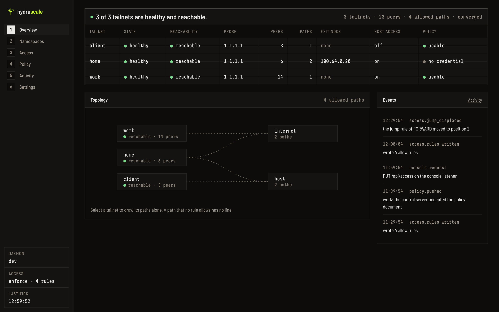
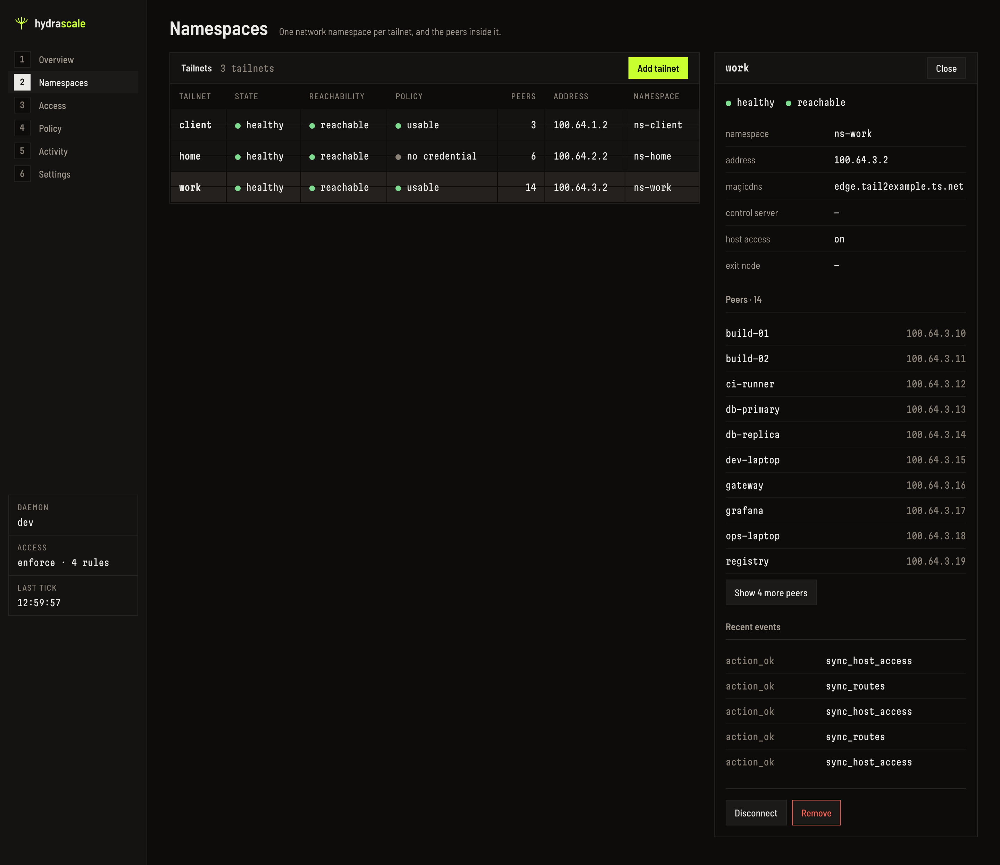

<p align="center">
  
</p>

<h1 align="center">Hydrascale</h1>

<p align="center"><b>Run multiple Tailscale tailnets simultaneously on a single Linux machine.</b></p>

<p align="center">
  <a href="https://github.com/Crank-Git/Hydrascale/actions/workflows/ci.yml"></a>
  <a href="https://github.com/Crank-Git/Hydrascale/releases"></a>
  
  
  <a href="LICENSE"></a>
</p>

<p align="center">
  <a href="https://crank-git.github.io/Hydrascale/"><b>Docs</b></a> ·
  <a href="#install"><b>Install</b></a> ·
  <a href="#quick-start"><b>Quick start</b></a> ·
  <a href="https://github.com/Crank-Git/Hydrascale/releases"><b>Releases</b></a>
</p>

<p align="center">
  
</p>

## Why Hydrascale

`tailscaled` holds one tailnet at a time. Fast user switching swaps between them, but it won't keep two up at once, and that's a problem when everyone you work with runs their own tailnet. Hydrascale keeps a Linux host on all of them simultaneously.

Each tailnet gets its own `tailscaled` in its own network namespace (`ns-<id>`), wired to the host by a veth pair and masqueraded out the host's interface. Every tailnet hands out addresses from the same `100.64.0.0/10` CGNAT range, so the namespaces are what keep overlapping addresses, routes, and exit nodes from colliding. Each `tailscaled` also gets its own UDP listen port (41641 plus its veth index), forwarded from the host, so peers can still reach each namespace directly.

The hard part was names. MagicDNS lives inside each namespace, so the host can't resolve any of it on its own. Hydrascale publishes peer names to the host, either as a managed block in `/etc/hosts` or as per-tailnet routing domains in `systemd-resolved`, and sends each tailnet's split DNS domains to that tailnet's resolver.

## Requirements

- **Linux, as root.** `hydrascale init` refuses to run as anyone else.
- **Tailscale**, with `tailscaled` and `tailscale` in `$PATH`.
- **iproute2** (`ip`), and **iptables** plus **ip6tables**. Most distributions ship both in the `iptables` package.
- **IP forwarding:** `sudo sysctl -w net.ipv4.ip_forward=1`.
- **Go 1.26 or later**, only if you build from source.

Kernel options and the IPv6 requirements are on the
[requirements page](https://crank-git.github.io/Hydrascale/get-started/requirements/).

## Install

Either way, the binary ends up at `/usr/local/bin/hydrascale`.

From a release: grab the archive for your host from
[GitHub Releases](https://github.com/Crank-Git/Hydrascale/releases), then:

```bash
tar xzf hydrascale_*.tar.gz
sudo install hydrascale /usr/local/bin/
```

From source:

```bash
git clone https://github.com/Crank-Git/Hydrascale.git
cd Hydrascale
go build -o hydrascale ./cmd/hydrascale
sudo install hydrascale /usr/local/bin/
```

`go install` won't work. The module path is just `hydrascale`, which the Go module proxy
can't fetch.

## Quick start

The wizard is the shortest path. It runs the preflight checks, writes the config, asks
for an auth key or a browser login, starts the first tailnet, and confirms it
authenticated:

```bash
sudo hydrascale init
```

To set it up by hand instead:

1. Write `/etc/hydrascale/config.yaml`:

    ```yaml
    version: 2
    tailnets:
      - id: corp-prod
      - id: homelab
        exit_node: exit-us.example.com
    access:
      mode: enforce
      rules:
        - from: corp-prod
          to: internet
        - from: homelab
          to: internet
    resolver:
      mode: unified
    reconciler:
      interval: 10s
    ```

2. Apply it once with `sudo hydrascale apply`, or run the daemon with
   `sudo hydrascale serve`. The daemon checks the host against the file on every tick
   (every 10 seconds here) and fixes anything that drifted.

3. Check on it with `sudo hydrascale status`, or open the console at
   `http://127.0.0.1:9443`.

Give it about 20 seconds after a start before you trust `hydrascale status`. Until then,
tailnets show `down` and `degraded`, which is normal. If one still says `down` after 60
seconds, something is actually wrong.

`mode: enforce` denies every path that no rule allows. If this host already uses its
tailnets, read [Local rules](https://crank-git.github.io/Hydrascale/concepts/local-rules/)
before you start the daemon.

Once it's running, the rest of the CLI works per tailnet: `exec` runs any command inside
a tailnet's namespace, `ping`, `ssh`, and `tailscale` do what you'd expect from there,
`env` prints the shell environment for one, and `wrap` generates a systemd drop-in that
runs a service inside one. `tui` opens a monitor against the running daemon, `diff`
shows what `apply` would change, and `add`, `remove`, `list`, `install`, and `uninstall`
manage the rest. Every command is on the
[command line page](https://crank-git.github.io/Hydrascale/reference/command-line/).

## The console

<p align="center">
  
</p>

The daemon serves the console on `127.0.0.1:9443`: namespaces, local rules, upstream
policy, and events. **Heads up:** the console has no authentication, and the daemon runs
as root. Any local account on this host can open it and control the daemon. Read
[Security](https://crank-git.github.io/Hydrascale/security/console/) before you run this
on a shared machine.

## Documentation

Everything else is on the [documentation site](https://crank-git.github.io/Hydrascale/).

| Section | What's there |
|---|---|
| [Home](https://crank-git.github.io/Hydrascale/) | What Hydrascale does and how the reconciler works. |
| [Get started](https://crank-git.github.io/Hydrascale/get-started/) | Requirements, install, and the quick start. |
| [Guides](https://crank-git.github.io/Hydrascale/guides/) | Console views, credentials, host access, and Headscale. |
| [Concepts](https://crank-git.github.io/Hydrascale/concepts/) | Local rules, upstream policy, DNS, and networking. |
| [Reference](https://crank-git.github.io/Hydrascale/reference/) | Config file, command line, environment variables, control API, events, and agent skills. |
| [Operations](https://crank-git.github.io/Hydrascale/operations/) | Daemon mode, remote access, upgrades, uninstall, and troubleshooting. |
| [Architecture](https://crank-git.github.io/Hydrascale/architecture/) | Namespaces, veth pairs, and the reconciler's managers. |
| [Security](https://crank-git.github.io/Hydrascale/security/) | The console risk, its four controls, and the security audit. |

## Agent skills

The binary ships a set of skills for coding agents, one Markdown file per task. Install
them as the account that runs your agent, without `sudo`:

```bash
hydrascale skills install
```

Each skill and flag is on the
[Agent skills](https://crank-git.github.io/Hydrascale/reference/skills/) page.

## License

MIT. See [LICENSE](LICENSE).

---

<sub>Built by <a href="https://github.com/Crank-Git">Crank</a> · <a href="https://github.com/Crank-Git">More projects</a></sub>
