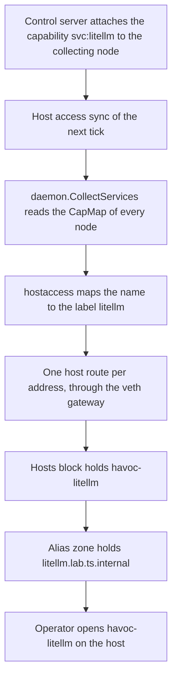
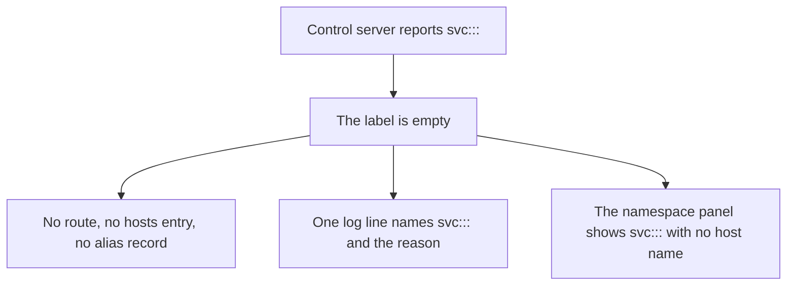

## Purpose

This is a delta feature. It extends the host access that `features/00-foundation.md`
describes, and it extends the alias zone that the decision of 2026-09-22 opened behind the
key `resolver.resolve_aliases`. A contributor proposed it in pull request #476 on
2026-10-26. The tracker holds no issue for it, and the work lives on the branch
`feat/tailscale-services`.

A Tailscale service is not a machine. The control server reports it as a capability of the
node that collects its endpoints, under the key `services/<name>` of the capability map.
The record names itself `svc:<name>`. `tailscale status --json` holds no peer entry for it.

Host access saw no route, no name, and no address for such a record. The operator reached a
service by typing one of its addresses. The name `svc:litellm` is not a DNS label, so the
host held no name for it.

The feature turns every service of a tailnet into host state. The daemon writes one host
route per address, one name in the hosts file, and one record in the alias zone. The
namespace panel of the console lists the service. The feature needs no configuration key,
no login flag, and no `--accept-routes`.

## Verified against

- `internal/daemon/daemon.go` reads the field `CapMap` of `tailscale status --json`.
  `internal/daemon/daemon_test.go` holds a trimmed sample of that output. The sample is a
  fixture that the branch wrote, not output captured from a tailnet.
- `internal/hostaccess/routes.go` already holds the two Tailscale address ranges
  `100.64.0.0/10` and `fd7a:115c:a1e0::/48`, and the reads of routing table 52 drop both.
  FR-svc-15 states what that means for a service address.
- The live check of 2026-10-29 ran on the test host against the service `svc:hydratest`
  of the tailnet `jbones`. It verified the read, the host route, the hosts record, the
  detail route, and the namespace panel. It did not verify the alias record, because the
  test host runs with `resolver.resolve_aliases` off.

## Decisions

- The host names a service `<tailnet-id>-<label>`, in the shape of a peer name. The hosts
  file, the alias zone, and the console then hold one word per service.
- The detail route states that name as a field, and the console derives nothing. The
  operator chose this on 2026-10-26, so the console and the host name a service the same
  way.
- The console lists the services of a tailnet and changes nothing. The control server is
  the only place that changes a service.

## User stories

- As an operator, I want a service of a tailnet to answer by name on the host, so that I
  use it the way I use a peer of that tailnet.
- As an operator, I want a service to need no configuration key, so that I keep no second
  list of what the tailnet already advertises.
- As an operator, I want the daemon to drop a name that is not a DNS label and to say why,
  so that the hosts file stays readable.
- As an operator, I want the console to show the services of a tailnet with their addresses
  and ports, so that I read one view instead of the hosts file.
- As an operator, I want the name in the console and the name on the host to match, so that
  I copy one word and it resolves.

## Functional requirements

### The read

- **FR-svc-1** — A Tailscale service reaches the daemon as a record of the `CapMap` field of
  `tailscale status --json`. The key holds the form `services/<name>`, and the record holds
  `Name`, `Addrs`, and `Ports`. The status holds no peer entry for a service.
- **FR-svc-2** — The daemon reads the capability map of every node of the status, its own
  node included. The daemon does not know which node collects the endpoints of a service.
- **FR-svc-3** — The daemon keeps a record when its key opens with `services/`, or when the
  record names itself with the prefix `svc:`. It keeps such a record only when the record
  holds a name and at least one address.
- **FR-svc-4** — The daemon skips a record that it cannot read as a service record. A
  capability key that holds records of another shape fails no status read and no reconcile
  tick.
- **FR-svc-5** — One service that two nodes report reaches the daemon once. Its addresses
  and its ports come from both reports, and a value that both reports hold appears once.
- **FR-svc-6** — The daemon lists the services in the order of their names, because a
  capability map holds no order.

### The name

- **FR-svc-7** — The host names a service `<tailnet-id>-<label>`, where `<label>` follows
  FR-svc-8 to FR-svc-10. The name follows the peer convention, so two tailnets that hold a
  service of one name hold two host names.
- **FR-svc-8** — The label drops the prefix `svc:` and the case of the name. It replaces
  every character that is not a letter, a digit or a hyphen with a hyphen, collapses the
  hyphens that touch, and trims both ends.
- **FR-svc-9** — A label holds 63 characters or fewer. The daemon cuts a longer name at 63
  characters and drops a hyphen left at the cut.
- **FR-svc-10** — A label is one DNS label: a letter or a digit, then letters, digits and
  hyphens, then a letter or a digit. The daemon drops a service whose label fails that
  shape. The name `svc:::` leaves no label, so the daemon writes no state for it.
- **FR-svc-11** — The daemon records one log line for each read that drops a service. The
  line names the reported name and states that it holds no DNS label.
- **FR-svc-12** — A peer that already holds the name keeps it, and the daemon writes no
  second record under that name. A peer `litellm` and a service `svc:litellm` of one
  tailnet hold one name, which is the peer's.
- **FR-svc-12a** — Two services of one tailnet whose names give one label hold one name.
  The service whose reported name sorts first keeps the name. The other service keeps every
  route of FR-svc-13, and it gets no hosts record and no alias record. The daemon records
  one log line that names the other service and the label.

### The routes

- **FR-svc-13** — The daemon writes one host route for every address of every service of
  the tailnet. The route has the shape of a peer route: through the veth gateway, on the
  veth device of the tailnet, in the table that `route_table` declares.
- **FR-svc-14** — The route diff of each host access sync removes the route of an address
  that the status no longer reports. A service that the control server removes leaves the
  host within one tick.
- **FR-svc-15** — The address of a service sits in `100.64.0.0/10` or in
  `fd7a:115c:a1e0::/48`. The reads of routing table 52 drop both ranges, so no accepted
  subnet route carries a service address. The route of FR-svc-13 is the only host path to a
  service.
- **FR-svc-16** — The daemon writes no rule in `HYDRASCALE-FWD` or `HYDRASCALE-OUT` for a
  service. The local rule `from: host, to: <tailnet>` gates a packet to a service address as
  it gates a packet to a peer.
- **FR-svc-17** — The daemon reads the ports of a service for the console alone. It opens no
  port on the host and writes no rule for a port.
- **FR-svc-18** — A tailnet whose host access is off gets no service route, no service name,
  and no alias record. The detail route of FR-svc-21 still lists its services.

### The names on the host

- **FR-svc-19** — The managed block of the hosts file holds the name of FR-svc-7 with the
  first IPv4 address and the first IPv6 address of the service. A hosts entry holds one
  address per family. Every other address of the service keeps its route of FR-svc-13.
- **FR-svc-20** — When `resolver.resolve_aliases` is on and the tailnet holds an alias, the
  alias zone holds `<label>.<alias>.ts.internal` for each address family of the service. A
  peer that holds that name in the zone keeps it.

### The control API and the console

- **FR-svc-21** — `GET /api/tailnet/{id}/detail` answers the services of the tailnet under
  `services`, in the order of the names, and it omits the key when the tailnet holds no
  service. Each entry holds `name`, `host_name`, `addrs`, and `ports`.
- **FR-svc-22** — `host_name` holds the name of FR-svc-7. It is absent when the reported
  name holds no label of FR-svc-10, and when FR-svc-12a gives the name to another service. The daemon computes it with the same function that
  writes the hosts record.
- **FR-svc-23** — A service is not a peer: it changes no peer count and no peer field of a
  control API response, and `GET /api/status` holds no service list.
- **FR-svc-24** — The namespace panel of the console holds one section `Services · <n>`
  between the peers and the recent events, when the tailnet holds a service. Each row holds
  the name, the addresses, and the ports in the mono typeface.
- **FR-svc-25** — A row names a service with the `host_name` of FR-svc-22. A row whose
  service holds no `host_name` shows the name that the control server reported.
- **FR-svc-26** — The panel draws no section when the tailnet holds no service. A service
  holds no state dot, because the status reports no state for it, and it takes no accent
  colour.

## User flows

### Flow 1: A tailnet advertises a service

1. The control server attaches the capability `svc:litellm` to the node that collects its
   endpoints, with the addresses of the service.
2. On the next host access sync, the daemon reads the capability map of every node of the
   status.
3. The daemon maps the name to the label `litellm`. The tailnet identifier gives the host
   name `havoc-litellm`.
4. The daemon writes one route per address, the hosts entry, and the alias record.
5. The operator opens `havoc-litellm`, and the service answers.

### Flow 2: A service name holds no DNS label

1. The control server reports the name `svc:::`.
2. The label of FR-svc-8 to FR-svc-10 is empty, so the daemon writes no route, no name, and
   no record.
3. The daemon records one log line that names the reported name and the reason.
4. The namespace panel still lists the service, with the reported name and no host name.

## Data touched

- The managed block of the hosts file gains one name per service, inside the block that host
  access already owns.
- The alias zone `<alias>.ts.internal` gains one record per service and per address family.
- The routing table that `route_table` declares gains one route per address of a service.
- `GET /api/tailnet/{id}/detail` gains the field `services`.
- No configuration key and no secrets file key appears. The daemon records no event for a
  service; it writes one log line for a name it drops.

## Interfaces

### The status

The field `CapMap` of `tailscale status --json` maps a capability key to a list of records.
A service key holds the form `services/<name>`. A record holds `Name`, `Addrs`, and `Ports`.
`Name` carries the prefix `svc:`, and `Ports` holds entries of the form `tcp:443`.
`internal/daemon/daemon.go` names the record `ServiceEndpoint` and returns the records of a
status through `CollectServices`.

### The control API

`GET /api/tailnet/{id}/detail` gains the field `services`, described by FR-svc-21 and
FR-svc-22. No other route changes.

### The console

The namespace panel gains the section that FR-svc-24 to FR-svc-26 describe.
`internal/ui/static/namespaces.js` builds it from the detail response, and it reads no other
route.

## Edge cases & failures

- Two nodes report one service. The daemon writes one set of routes and one name, because
  the service arrives once (FR-svc-5).
- A capability key of the form `services/…` holds a record of another shape. The daemon
  skips that record and reads the rest of the status (FR-svc-4).
- A record holds a name and no address. The daemon drops it, because no route and no name
  reaches it (FR-svc-3).
- A service label equals the hostname of a peer of the same tailnet. The peer keeps the name
  (FR-svc-12), and every address of the service keeps its route (FR-svc-13).
- Two names give one label, such as `svc:my-app` and `svc:my_app`. The name `svc:my-app`
  sorts first and keeps `<tailnet-id>-my-app`. The service `svc:my_app` keeps its routes
  and gets no `host_name` (FR-svc-12a, FR-svc-22).
- A name holds only characters outside the label shape, such as `svc:::`. The daemon drops
  the service and records the reason (FR-svc-10, FR-svc-11).
- The control server removes a service. Its route leaves within one tick (FR-svc-14), and
  the hosts file and the alias zone lose its name on the same sync.
- Host access turns off for the tailnet. The teardown removes its routes, and the names of
  its services leave the managed block with the names of its peers (FR-svc-18).
- `resolver.resolve_aliases` is off, or the tailnet holds no alias. The alias record is
  absent, and the hosts entry stays (FR-svc-20).

## Acceptance criteria

- `TestStatusNodeServicesReadsAServiceOffTheCapabilityMap`,
  `TestCollectServicesReportsOneServiceOnce`, and
  `TestCollectServicesReturnsNothingForAStatusWithoutACapabilityMap` in
  `internal/daemon/daemon_test.go` cover FR-svc-1 to FR-svc-6.
- `TestServiceLabelMapsEveryCharacterThatIsNotADNSLabel` and
  `TestParseServicesDropsANameWithoutALabelAndAnEntryThatIsNotAnAddress` in
  `internal/hostaccess/peers_test.go` cover FR-svc-8 to FR-svc-11.
- `TestBuildServiceRecordsNamesAServiceAfterTheTailnet`,
  `TestServiceHostNameNamesAServiceAsTheHostDoes`, and
  `TestAddServiceAliasRecordsKeepsANameThatAPeerHolds` cover FR-svc-7, FR-svc-12, and
  FR-svc-20.
- `TestParseServicesGivesALabelThatTwoServicesShareToTheFirstOnly` and
  `TestServiceHostNamesStatesAHostNameThatTwoServicesShareOnce` cover FR-svc-12a and the
  absent `host_name` of FR-svc-22.
- `TestUpdateHostsFileHoldsTheRecordOfAService` covers the hosts entry of FR-svc-19.
- `TestSyncHostRoutesWritesAHostRouteForEveryAddressOfAService` asserts one
  `ip route replace` per address of a service, which covers FR-svc-13. The removal of a
  service route follows the route diff that host access already holds, and no test names it.
- `TestDetailEndpoint_HoldsTheServicesOfTheTailnet` and
  `TestDetailEndpoint_StatesNoHostNameForAServiceThatHoldsNoDNSLabel` in
  `internal/api/server_test.go` cover FR-svc-21 to FR-svc-23.
- Five tests in `internal/ui/jstest/namespaces.test.mjs` cover FR-svc-24 to FR-svc-26: the
  host name, the absent service list, the fallback name, the place of the section, and the
  mono typeface.
- FR-svc-15 and FR-svc-16 hold no test. They state which path a service address does not
  take. The live check of 2026-10-29 observed FR-svc-15 on the test host.

## Out of scope

- A configuration key that selects or names a service. The status is the only source.
- A daemon change to a capability map. The console offers no control for a service.
- A firewall rule or a port rule that follows a service. `features/17-published-ports.md`
  governs a port of the host.
- A state, a health check, or an online flag for a service. The status reports none.
- One hosts entry per address of a service. The entry holds one address per family.
- `tailscale serve` and `tailscale funnel`, which publish a port of a node through the
  control server.

## Open questions

- Should a service name that a peer already holds record an event, as a split DNS conflict
  does? The daemon is silent today (FR-svc-12).
- Should `GET /api/status` carry a service count for a tailnet? It holds none today.
